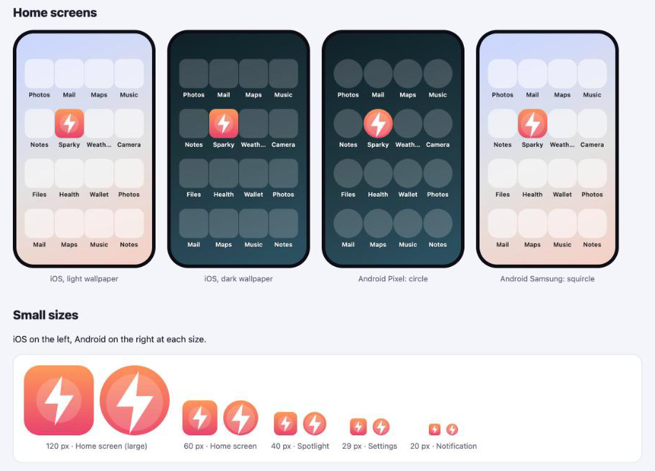

# Claude Skills for mobile developers

[Claude Code](https://claude.com/claude-code) skills for building and shipping iOS and Android apps. Each skill also works on its own without Claude Code.

---

## Skills

| Skill | What it does | Command |
|---|---|---|
| [**app-icon-generator**](plugins/app-icon-generator) | Preview your app icon on iOS and Android home screens, adjust size and position, and generate every icon size: `AppIcon.appiconset`, Android mipmaps, adaptive icons. Installs them into Flutter, React Native, Expo or native projects. | `/app-icon` |
| [**apk-sign**](plugins/apk-sign) | Sign or re-sign an Android APK with any keystore (`.jks`, `.p12`, `.pk8` + `.pem`), verify it, and install it with adb. macOS, Linux and Windows. | `/sign-apk` |



---

## Install

Add this marketplace once:

```
/plugin marketplace add sabuhiamirov/claude-skills
```

Then install the skills you want:

```
/plugin install app-icon-generator@sabuhiamirov
/plugin install apk-sign@sabuhiamirov
```

Restart Claude Code, then use the command from the table or just ask, for example "fix the app icon" or "sign this APK with my release key".

<details>
<summary>Install without the plugin system (copy a skill)</summary>

<br>

Copy a skill folder from `plugins/<plugin>/skills/` to:

- `~/.claude/skills/` to use it in all projects, or
- `<your-project>/.claude/skills/` to use it in a single project

</details>

---

## Update

```
/plugin marketplace update sabuhiamirov
```

---

## Without Claude Code

Every skill has a README with instructions for using it on its own:

- [app-icon-generator](plugins/app-icon-generator#option-b-without-claude-code): an HTML page that runs in your browser
- [apk-sign](plugins/apk-sign#option-b-without-claude-code): a script for macOS, Linux and Windows

---

## License

[MIT](LICENSE)
