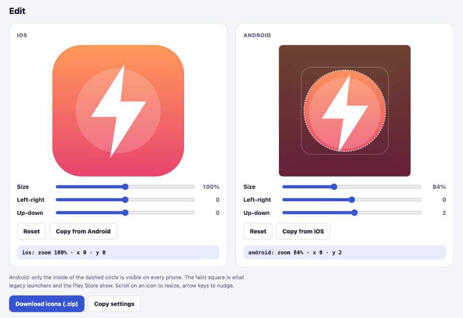
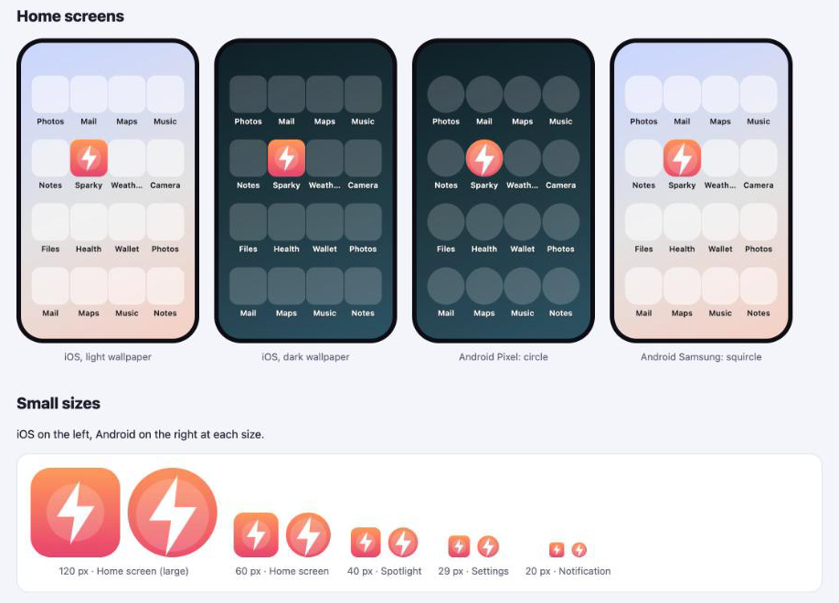

# App Icon Generator for iOS and Android

See your app icon on iOS and Android home screens, drag and resize it until it fits, and download **every launcher icon size in one ZIP**.

Use it as a [Claude Code](https://claude.com/claude-code) skill that also installs the icons into your project, or just open the HTML page in your browser.

> **Not using Claude Code?** Go to [Option B](#option-b-without-claude-code). Open one HTML file in your browser and download the icons. Nothing to install.



---

## Why

Common app icon problems this fixes:

- The icon looks **too big, too small, cut off or off-centre** on the home screen
- Android's **adaptive icon** mask crops the logo
- You need all the sizes for a **Flutter, React Native, Expo, Capacitor or native** app

You see the result on real-looking home screens before you generate anything:



---

## Features

- **Live previews:** iOS on light and dark wallpaper, Android with circle (Pixel) and squircle (Samsung) masks, and small sizes down to 20 px.
- **Android safe zone:** the 66 dp circle that every launcher shows is drawn on the editor, so nothing important gets cropped.
- **Separate settings per platform:** iOS and Android each get their own zoom and position.
- **Smart fill:** when the artwork is shrunk, the empty space is filled with a gradient sampled from the image edges. You can change the colours.
- **App Store ready:** iOS PNGs have no alpha channel, so App Store Connect accepts them.
- **Private and offline:** everything runs in your browser. Your image is never uploaded, and nothing needs to be installed.

---

## How it works

```
your-icon.png  ──▶  editor in the browser  ──▶  app-icons.zip  ──▶  your project
                    (adjust iOS and Android)     (every size)        (ios/ and android/ folders)
```

1. **Open** the editor with your image.
2. **Adjust** size and position for iOS and Android. Drag the icon, use the sliders, scroll to resize, or nudge with the arrow keys.
3. **Download icons (.zip)** gives you every file.
4. **Install:** Claude Code copies the files into your project, or you copy them yourself (see [Where the files go](#where-the-files-go)).

The page has two buttons:

| Button | What it does |
|---|---|
| **Download icons (.zip)** | Saves all icon files as one ZIP |
| **Copy settings** | Copies only the numbers you chose (zoom, position, colours) as text, so you can save them or make the same icons again later. It doesn't copy images. |

---

## Option A: with Claude Code

Install it once:

```
/plugin marketplace add sabuhiamirov/claude-skills
/plugin install app-icon-generator@sabuhiamirov
```

Then, in your app project:

```
/app-icon
```

You can also just ask, for example:

- "the app icon looks too big on Android, fix it"
- "make app icons from assets/logo.png"

Claude then:

1. finds the source image in your project
2. opens the editor in your browser and waits while you adjust it
3. takes the ZIP you downloaded
4. detects your project type and shows which files will be replaced
5. installs the icons after you say yes

<details>
<summary>Install without the plugin system (copy the skill)</summary>

<br>

Copy `plugins/app-icon-generator/skills/app-icon` to:

- `~/.claude/skills/app-icon` to use it in all projects, or
- `<your-project>/.claude/skills/app-icon` to use it in a single project

</details>

---

## Option B: without Claude Code

1. Download this repository (green **Code** button → *Download ZIP*, or `git clone`).
2. Open `plugins/app-icon-generator/skills/app-icon/assets/editor.html` in Chrome, Safari, Edge or Firefox.
3. Choose or drop your image. A square 1024×1024 PNG works best.
4. Adjust it, then click **Download icons (.zip)**.

To open the page with your image and app name already loaded:

```bash
python3 plugins/app-icon-generator/skills/app-icon/scripts/make_editor.py path/to/icon.png --name "My App" --open
```

This uses only the Python 3 standard library.

---

## What's in the ZIP

| Path | Contents |
|---|---|
| `ios/AppIcon.appiconset/` | `Contents.json` + 15 PNGs: every iPhone and iPad size and the 1024×1024 App Store icon |
| `android/res/mipmap-{mdpi…xxxhdpi}/` | `ic_launcher.png`, `ic_launcher_round.png`, `ic_launcher_foreground.png` |
| `android/res/mipmap-anydpi-v26/` | `ic_launcher.xml`, `ic_launcher_round.xml` (adaptive icon, Android 8+) |
| `android/res/values/` | `ic_launcher_background.xml` (background colour) |
| `store/` | `app-store-1024.png`, `play-store-512.png`, `android-adaptive-foreground-1024.png` |
| `settings.json` | The zoom, position and colours you used |

File names match the Flutter and Android Studio templates, so the folders can replace the existing ones directly.

---

## Where the files go

| Project | iOS | Android |
|---|---|---|
| Flutter | `ios/Runner/Assets.xcassets/AppIcon.appiconset` | `android/app/src/main/res` |
| React Native | `ios/<AppName>/Images.xcassets/AppIcon.appiconset` | `android/app/src/main/res` |
| Capacitor / Ionic | `ios/App/App/Assets.xcassets/AppIcon.appiconset` | `android/app/src/main/res` |
| Native | your `Assets.xcassets/AppIcon.appiconset` | `app/src/main/res` |

- **iOS:** replace the contents of the `AppIcon.appiconset` folder.
- **Android:** merge `android/res` into your `res` folder. `AndroidManifest.xml` should have `android:icon="@mipmap/ic_launcher"` and `android:roundIcon="@mipmap/ic_launcher_round"`.
- **Expo:** in `app.json`, set `icon` to `store/app-store-1024.png`, `android.adaptiveIcon.foregroundImage` to `store/android-adaptive-foreground-1024.png`, and `backgroundColor` to the colour in `ic_launcher_background.xml`.

> **Not seeing the new icon?** iOS and many Android launchers cache icons. Delete the app from the device or simulator and install it again.

---

## How the editor maps to the real icon

**iOS.** The whole square is the icon. iOS rounds the corners itself, so the files are plain squares without transparency.

**Android adaptive icon.** The editor square is the 108 dp foreground layer. Launchers show the middle 72 dp through a mask (circle, squircle, rounded square…). Only the 66 dp circle in the centre is guaranteed to be visible everywhere; that is the dashed circle. The faint square is the 72 dp area used for the legacy `ic_launcher.png` and the Play Store icon.

**Numbers.** Zoom is the artwork size in percent of the icon. Left-right and up-down move it in percent of the icon size.

---

## FAQ

**Why not just use a single 1024 icon?**
Xcode 14+ can generate the iOS sizes from one image, but Flutter and React Native templates, older Xcode versions and Android still need the separate files. The ZIP contains both.

**My image has a transparent background.**
That works. The transparent parts show the fill colour, which you can pick in the editor.

**Does it support monochrome (themed) Android 13 icons?**
Not yet.

---

## License

[MIT](../../LICENSE)
